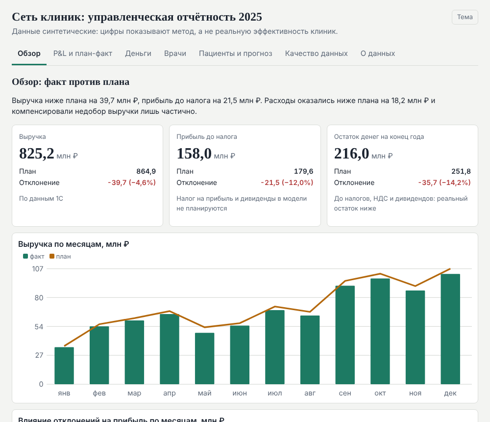
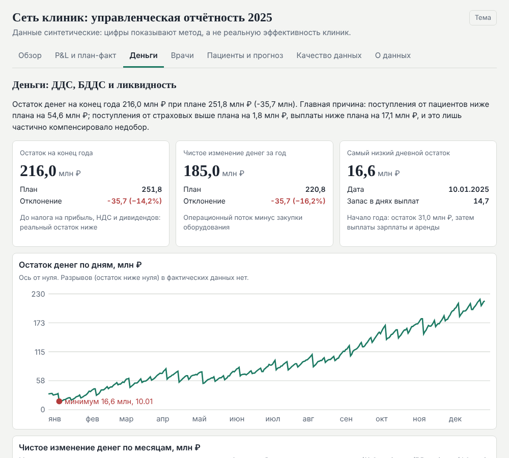
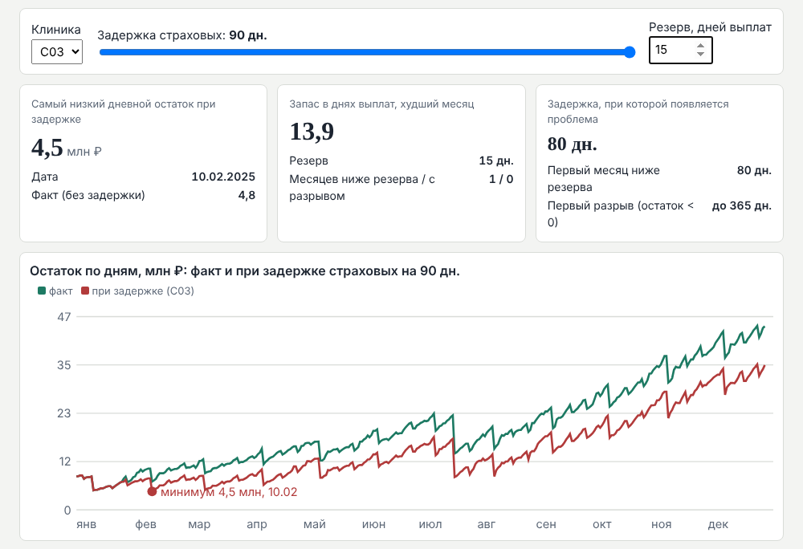
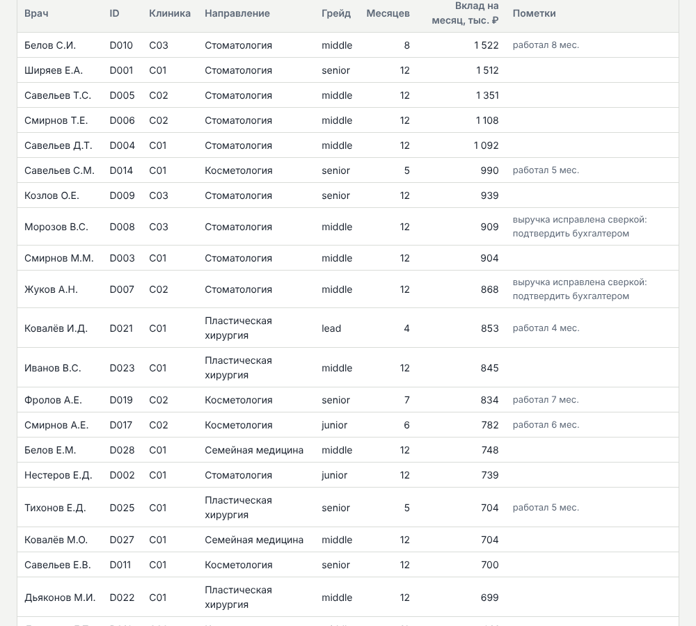
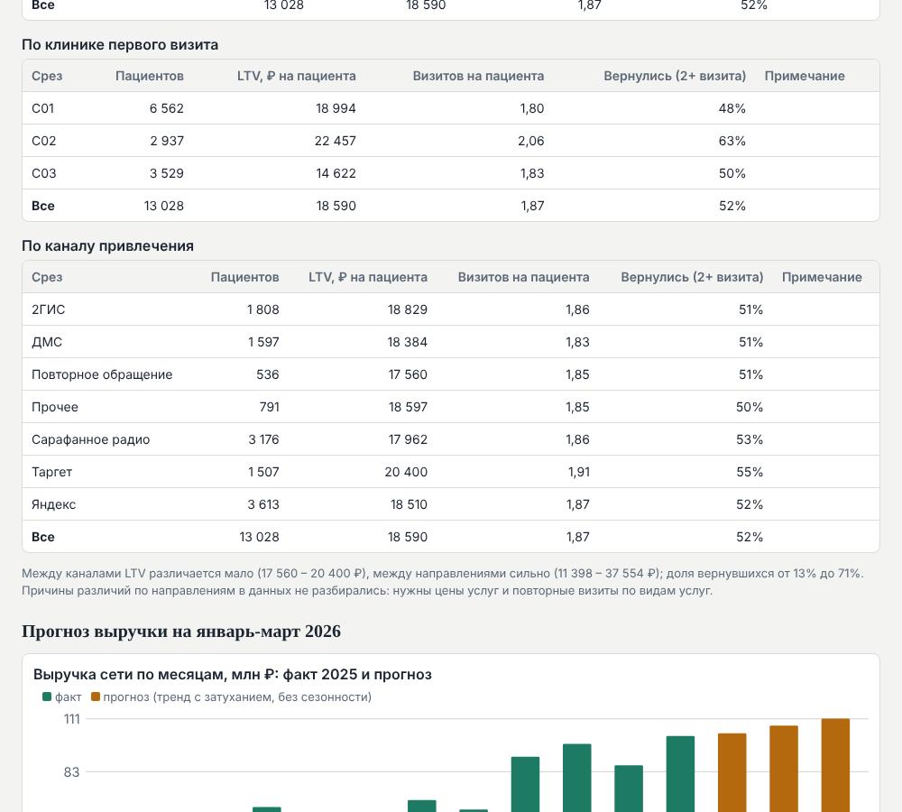

# AI-аналитик для сети клиник

Демо-проект финансового аналитика: от сверки данных ERP и 1С до отчётности, дашборда, SQL-запросов и ИИ-агента. Вымышленная сеть из трёх клиник эстетической медицины, календарный 2025 год. **Все данные синтетические: цифры показывают метод, а не реальную эффективность бизнеса.**

Автор: Олег Кочиерь, финансовый аналитик (управленческая отчётность, BI, ИИ-агенты).

Репозиторий: [github.com/Poliduris1977/clinic-ai-analyst-public1](https://github.com/Poliduris1977/clinic-ai-analyst-public1) · Онлайн-дашборд: [poliduris1977.github.io/clinic-ai-analyst-public1](https://poliduris1977.github.io/clinic-ai-analyst-public1/) · Агент: [demo/Agent_2025.html](https://poliduris1977.github.io/clinic-ai-analyst-public1/demo/Agent_2025.html)

**За минуту:** [одностраничник](https://poliduris1977.github.io/clinic-ai-analyst-public1/one-pager.html) — кто я и что подтверждено; [полное описание проекта](https://poliduris1977.github.io/clinic-ai-analyst-public1/project.html) — выводы и ограничения (исходники: [`docs/ONE_PAGER.md`](docs/ONE_PAGER.md), [`docs/PROJECT.md`](docs/PROJECT.md)).

Проект сделан как демонстрация рабочего процесса вместо резюме: каждое число воспроизводится скриптами, а результаты проходят автоматические проверки (ниже).

## Что внутри

| Блок | Что делает | Результат на данных проекта |
|---|---|---|
| Сверка ERP и 1С | 16 типов ошибок, правила «объясняй и вычитай», исправления с основанием и уровнем уверенности | на своём наборе 14 из 14 (регрессионный тест); слепой тест на втором наборе: первый прогон 10 из 14, после доработки правил 14 из 14 (доработка не слепая) |
| P&L, план-факт, факторный анализ | прибыль, прямая и валовая маржа, мосты план-факт | прибыль до налога 158,05 млн ₽ при плане 179,56 (−21,52); прямая маржа 727,46 → 690,50 млн ₽ |
| Врачи | вклад на врача-месяц по грейдам, калькулятор оплаты «что если» | 43 врача, вклад 361,13 млн ₽; на врача-месяц 613 / 765 / 826 / 853 тыс. ₽ (junior … lead, в lead один врач) |
| ДДС, БДДС, ликвидность | факт и план, остаток по дням, стресс задержки страховых | остаток на конец года 216,04 млн ₽ (план 251,78), минимум дня 16,6 млн ₽ 10 января, до налогов и дивидендов |
| LTV пациентов | когорты по месяцу первого визита, срезы | 27 924 новых пациента; январская когорта 1 287 человек, LTV за 12 месяцев 34 101 ₽ |
| Прогноз I квартала 2026 | тренд с затуханием, откат на 2025 годе, коридор и надёжность | сеть 322,6 млн ₽, коридор 257–388; по трём направлениям надёжность низкая |
| Дашборд | семь вкладок в одном HTML-файле, стресс считается в браузере | 69 проверок при сборке |
| ИИ-агент | шесть вопросов демо, числа только из функций, журнал | 44 из 44 тестов |
| SQL-слой | девять запросов на SQLite, воспроизводят контрольные цифры из исходных таблиц | 31 из 31 |
| Регламент закрытия месяца | шаги, роли, календарь, критерии | `docs/REGLAMENT.md` |

## Как это выглядит

Живая версия по ссылке выше; готовые файлы лежат и в `demo/` (скачайте и откройте в браузере, GitHub сам HTML не отображает).





Стресс задержки страховых считается в браузере по дневным рядам клиник; на скриншоте клиника C03, задержка 90 дней, резерв 15 дней: один месяц ниже резерва, разрыва нет.







## Запуск

Нужны Python 3.12+ и LibreOffice (пересчитывает формулы в xlsx; без него книги откроются в Excel, но контроли не смогут прочитать значения формул).

```
pip install -r requirements.txt
python src/run_chain.py
```

Цепочка (около минуты) создаёт папку `data/`: синтетические данные, сверку, исправления, все книги, слепой тест, дашборд, агента и проверки. Сиды зафиксированы, результат воспроизводится. Ожидаемые итоги в конце: агент 44 из 44, контроли 40 из 40, SQL 31 из 31, дашборд 69 проверок.

Отдельно: `python src/dashboard/build_dashboard.py data/reports/Dashboard_2025.html` (только дашборд), `python src/sql/run_sql.py` (SQL-контроли). На Windows перед запуском: `$env:PYTHONUTF8 = "1"` и путь к LibreOffice в `PATH`.

## Как проверяется результат

- **Контрольные цифры** (`src/check_controls.py`): выручка ERP 825 211 700 ₽ и 1С 825 211 796 ₽ (разница 96 ₽ — округление цен), прибыль, остаток, разложения факторов, формулы книг без ошибок.
- **SQL независимо от Python:** `sql/` пересчитывает выручку, прибыль, остаток, остаток по дням, стресс и LTV из исходных таблиц; на «грязных» данных сверка находит 10 существенных расхождений, на исправленных ни одного.
- **Числа в тексте** ответов агента и дашборда берутся из функций и сверяются с реестром при сборке.

## Ограничения (читать до выводов)

- Данные синтетические; экономика откалибрована под типичную для частной медицины. Налог на прибыль, НДС и дивиденды не моделируются, остаток денег показан до налогов.
- Правила сверки писались при известных типах ошибок: «14 из 14» это регрессионный тест. Обобщаемость проверена слепым тестом, а повторный результат 14 из 14 показывает закрытие известных дыр, не обобщаемость (`docs/BLIND_RESULT.md`).
- Прогноз это тренд одного года без сезонности, а не бюджет. По косметологии, пластике и лазерной коррекции зрения он ненадёжен (ошибка отката 39%, 78%, 50%), а на эти направления приходится 49% прогноза сети.
- Стресс задержки страховых сдвигает только их поступления; частичные оплаты, отсрочки поставщикам и реакция управления не моделируются.
- ИИ-агент это маршрутизатор по ключевым словам и набор функций, не языковая модель.
- Исправления средней уверенности (выбор проводки, врач по расчёту зарплаты) требуют подтверждения бухгалтером.
- В проекте нет данных CRM и реальной 1С 8.3, не используются Power Query и Power Pivot, KPI персонала (кроме врачей) не считаются.

Полный список допущений: `docs/ASSUMPTIONS.md`.

## Структура

```
src/generate/    синтетические данные и внесение ошибок
src/reconcile/   сверка ERP и 1С, исправления
src/reports/     книги: P&L, план-факт, факторный анализ, врачи, ДДС, LTV, прогноз
src/dashboard/   сборка дашборда (build_dashboard.py + dashboard_template.html)
src/agent/       ИИ-агент (функции, паспорта, HTML)
src/blind/       слепой тест сверки
src/sql/, sql/   SQLite-база и девять запросов
src/common/      проводки, расчёт оплаты врачей, прогноз
docs/            одностраничник, описание проекта, допущения, регламент, слепой тест, карта проекта
demo/            готовые дашборд, агент, книги и скриншоты
```

## Документы

- `docs/ONE_PAGER.md` — одностраничник: кто я, что показали данные, требования вакансии и где они подтверждены, чего у меня нет.
- `docs/PROJECT.md` — полное описание проекта.
- `docs/ASSUMPTIONS.md` — допущения и ограничения.
- `docs/REGLAMENT.md` — регламент закрытия месяца (по процессу проекта, сроки и роли предложены автором).
- `docs/MAP.md` — карта кода и данных.
- `docs/BLIND_RESULT.md`, `docs/BLIND_SCHEMA.md` — слепой тест сверки.
- `sql/README.md` — SQL-запросы и ожидаемые значения.

Ссылки вида «п. 52» в `ASSUMPTIONS.md` и `BLIND_RESULT.md` указывают на рабочий журнал решений автора; в репозиторий он не входит.

## Лицензия

MIT, см. `LICENSE`.
